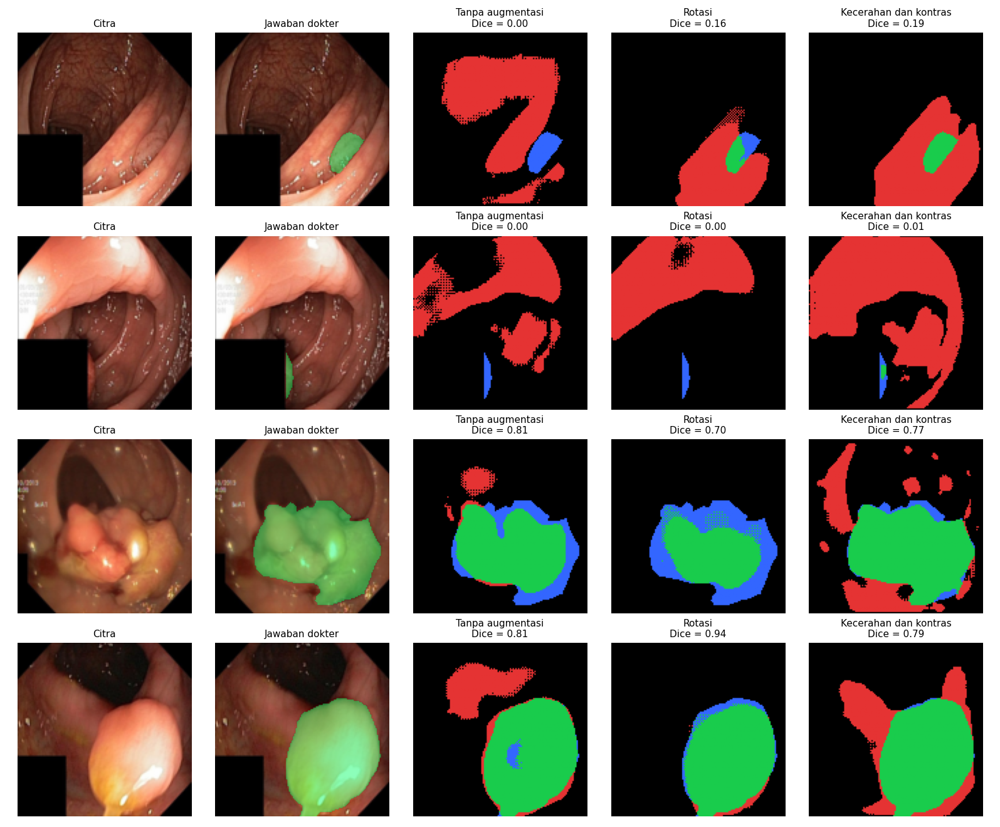

# Segmentasi Polip pada Citra Kolonoskopi dengan U-Net

<!--
  TEMPLATE LAPORAN — Tugas P10 Kecerdasan Buatan (BM25-41204), Teknik Biomedis ITERA.
  Petunjuk lengkap: https://mctm.web.id/ai-bm/tugas

  Cara memakai:
  - Ganti semua teks yang diawali "✍️" dengan tulisan kelompokmu, lalu hapus tanda ✍️-nya.
  - Blok komentar seperti ini adalah petunjuk; tidak tampil di GitHub. Boleh dihapus.
  - Gambar diambil dari folder hasil/ yang dibuat otomatis oleh notebook.
  - Jangan hapus judul-judul bagian (##).
-->

**Tugas P10 — Kecerdasan Buatan (BM25-41204), Teknik Biomedis ITERA**

## Anggota kelompok

| Nama | NIM | Username GitHub | Kontribusi utama |
|---|---|---|---|
| Anggun Melani Putri | 123430016 | anggun-melani123430016 | Processing vscode, bagian 5, bagian 6|
| Fadhilah U | 123430004 | dindafadhilah22-bot | Processing dan pengaturan skenario augmentasi, bagian 2,3,4|

## 1. Pertanyaan

Augmentasi apa yang membantu U-Net menemukan polip pada citra kolonoskopi, dan augmentasi apa yang tidak? Kenapa?

## 2. Data & pengaturan

<!-- Isi dari Bagian 2 notebook. Pastikan CEPAT = False untuk hasil akhir. -->
-Dataset: Kvasir-SEG, terdiri dari 1.000 citra kolonoskopi beserta mask segmentasi polip.
-Ukuran citra: 128 × 128 piksel.
-Data uji: 200 citra (tetap).
-Data latih: 800 citra per pengulangan.
-Model: U-Net mini (sekitar 0,5 juta parameter).
-Jumlah epoch: 30 epoch per pelatihan.
-Pengulangan: 3 kali untuk setiap skenario.
-Lingkungan pelatihan: Google Colab dengan GPU T4.


## 3. Skenario augmentasi & hipotesis

<!-- Tulis bagian ini SEBELUM menjalankan eksperimen. Commit dulu, baru jalankan.
     Alasan klinis = kenapa variasi ini mungkin (atau tidak mungkin) terjadi pada kolonoskopi sungguhan. -->

| Skenario | Augmentasi (kode) | Alasan klinis | Hipotesis: Dice naik/turun/sama? |
|---|---|---|---|
| Tanpa augmentasi | — | Pembanding | — |
| Rotasi | 'v2.RandomRotation(degrees=180)' | Posisi dan orientasi polip pada citra kolonoskopi dapat berbeda karena perubahan sudut pandang kamera endoskop selama pemeriksaan. | Dice diperkirakan meningkat karena model dilatih mengenali polip dalam berbagai orientasi, bukan hanya orientasi seperti pada data asli. |
| Perubahan pencahayaan + blur | 'v2.ColorJitter(brightness=0.3, contrast=0.3)'
'v2.GaussianBlur(kernel_size=5, sigma=(0.1, 2.0))'| Citra kolonoskopi dapat memiliki tingkat pencahayaan dan ketajaman yang berbeda akibat perubahan jarak kamera, pencahayaan, pantulan cahaya, maupun pergerakan endoskop. | Dice diperkirakan meningkat jika model lebih tahan terhadap variasi kualitas citra. Namun, blur berlebihan dapat menurunkan Dice karena batas polip menjadi kurang jelas. |

Contoh augmentasi yang dicoba:
https://colab.research.google.com/drive/1mtwwwbtyoa9EaAPkMem4zodF6jGdFEuC#scrollTo=6389f853&fullscreenOutput=true 
<!-- Ganti nama file sesuai skenario kalian (lihat isi folder hasil/). -->

## 4. Hasil

<!-- Tempel isi hasil/ringkasan.md di sini. -->

| Skenario | Dice (rata-rata ± sb) | IoU (rata-rata ± sb) | Dice tiap ulangan |
|---|---|---|---|
| Tanpa augmentasi | 0.372 ± 0.000 | 0.263 ± 0.000 | 0.372 |
| Rotasi | 0.373 ± 0.000 | 0.257 ± 0.000 | 0.373 |
| Kecerahan dan kontras | 0.331 ± 0.000 | 0.220 ± 0.000 | 0.331 | 

https://colab.research.google.com/drive/1mtwwwbtyoa9EaAPkMem4zodF6jGdFEuC#scrollTo=14dd4f45&fullscreenOutput=true

## 5. Analisis peta kesalahan



Berdasarkan hasil visualisasi peta kesalahan, terlihat bahwa kemampuan model U-Net dalam melakukan segmentasi polip berbeda pada setiap skenario augmentasi. Warna hijau menunjukkan prediksi yang benar (true positive), warna merah menunjukkan kesalahan prediksi berupa false positive, sedangkan warna biru menunjukkan false negative atau bagian polip yang tidak berhasil terdeteksi.

Pada skenario tanpa augmentasi, model menunjukkan hasil yang bervariasi. Beberapa citra memperoleh nilai Dice 0.00, yang menunjukkan bahwa prediksi model belum berhasil sesuai dengan mask dokter. Namun, pada citra lainnya model mampu melakukan segmentasi dengan baik, dengan nilai Dice mencapai 0.90 dan 0.95.

Pada skenario augmentasi rotasi, model belum menunjukkan peningkatan yang konsisten. Hal ini terlihat pada salah satu citra dengan nilai Dice yang menurun dari 0.90 menjadi 0.63. Meskipun demikian, pada citra lainnya hasil segmentasi masih relatif baik dengan nilai Dice 0.94.

Sementara itu, skenario perubahan kecerahan dan kontras menunjukkan penurunan hasil pada contoh yang diamati. Nilai Dice pada dua citra yang sebelumnya memperoleh 0.90 dan 0.95 menurun menjadi 0.54 dan 0.80. Area false positive yang cukup luas menunjukkan bahwa model masih kesulitan membedakan polip dengan jaringan di sekitarnya setelah mendapatkan variasi pencahayaan dan kontras.

Secara keseluruhan, visualisasi menunjukkan bahwa augmentasi tidak selalu meningkatkan kemampuan segmentasi. Perubahan citra yang terlalu berbeda dari karakteristik data asli berpotensi membuat model kesulitan mengenali batas polip. Namun, kesimpulan akhir tetap perlu didasarkan pada seluruh hasil pengujian dan perbandingan nilai Dice dari tiga kali pengulangan setiap skenario.
https://colab.research.google.com/drive/1mtwwwbtyoa9EaAPkMem4zodF6jGdFEuC#scrollTo=0b460587&fullscreenOutput=true

## 6. Pembahasan & kesimpulan

<!-- Bandingkan hasil dengan hipotesis di Bagian 3. Hipotesis yang ternyata salah tetap bernilai,
     asalkan dijelaskan kenapa. Perbedaan kecil (lebih kecil dari simpangan baku) belum tentu berarti. -->

✍️

## 7. Pembagian kerja

<!-- Siapa mengerjakan apa. Penilaian proses kerja dilihat dari riwayat commit tiap anggota. -->

✍️

## 8. Penggunaan AI

<!-- Wajib diisi, walau tidak memakai AI (tulis "Tidak memakai AI").
     Contoh: "Claude Code (CLI) untuk menulis skenario augmentasi dan memperbaiki error di Bagian 4.
     Draf Bagian 6 ditulis sendiri, lalu dirapikan bahasanya dengan bantuan AI." -->

✍️

## Cara menjalankan ulang

```bash
uv sync
uv run jupyter lab segmentasi_polip.ipynb
```

Atau buka notebook di Google Colab (Runtime → Change runtime type → T4 GPU).

## Referensi

- Jha, D., dkk. (2020). Kvasir-SEG: A Segmented Polyp Dataset. *MultiMedia Modeling (MMM 2020)*, 451–462.
- Ronneberger, O., Fischer, P., & Brox, T. (2015). U-Net: Convolutional Networks for Biomedical Image Segmentation. *MICCAI*. arXiv:1505.04597.
- ✍️ tambahkan referensi lain yang kalian pakai
